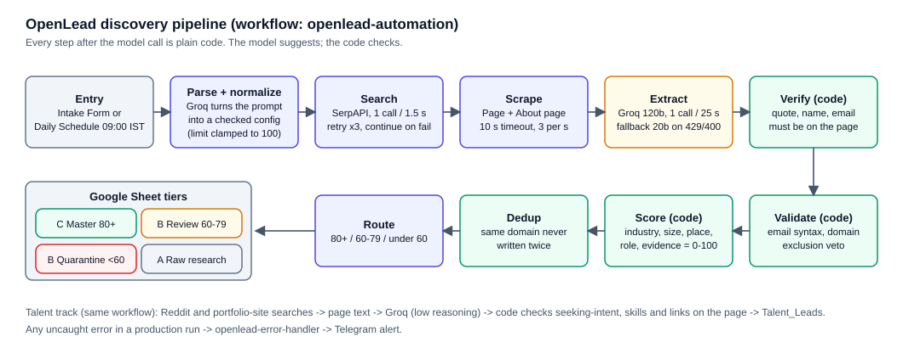
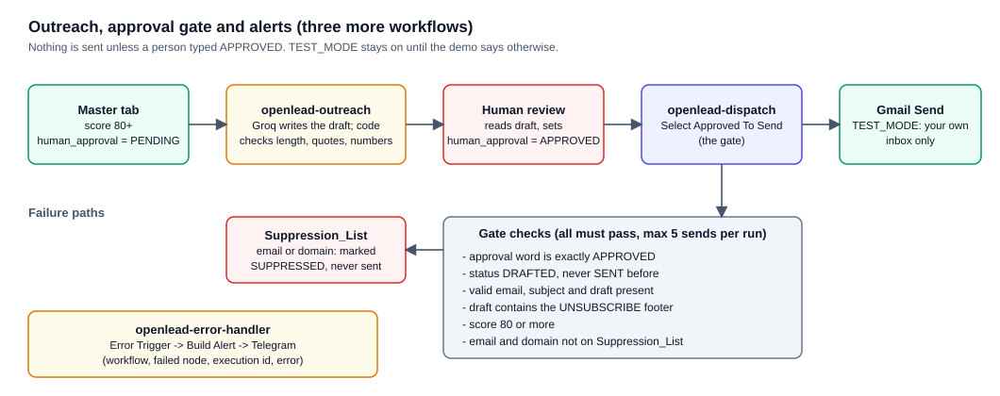

# Architecture

Two diagrams, both plain SVG (open in any browser, no tools needed).

## 1. Discovery pipeline

The rule that runs through the whole design: **the model suggests, the code decides.** Groq reads a page and proposes facts. Plain code then keeps a name, email, quote, skill or link only if the same text is on the page, computes the score, and picks the tier. The model never sets a score or a route.

| Stage | Workflow node(s) | Guard |
|---|---|---|
| Entry | Intake Form, Daily Schedule | the daily cron only fires while the workflow is Active |
| Parse | Parse Prompt (Groq), Parameter Normalizer | limit clamped to 100, contradictions and empty prompts rejected |
| Search | Split Queries, SerpAPI Request, Extract Hits | 1 call / 1.5 s, 3 tries, junk and directory domains blocked |
| Scrape | Scrape Page, Clean Page Text, Add About URL, Scrape About | 10 s timeout, no bypass of 403, parked pages flagged |
| Extract | Build LLM Context, Groq Extract, fallback | 4,500-character context cap, 1 call / 25 s, 429 and schema errors retried on the 20b model |
| Verify | Verify Extraction | every quote, name and email must be on the page |
| Validate | Validation Controller | email syntax and domain match, exclusion-keyword veto, decision maker must be supported by the page |
| Score | Scoring Engine | place must be proven on the page to reach Master |
| Dedup | Read Master Domains, Drop Existing Master, Dedup Check | a domain already in Master is never written twice |
| Route | Score Router, Prepare Rows, Write nodes | 80+ Master, 60-79 Review, under 60 Quarantine |

Talent track (same workflow, Reddit and personal-portfolio searches): Build Talent Context, Groq Talent Extract, Verify & Score Talent. Skills and links are kept only if they are on the page, a snippet-only lead can never be QUALIFIED, and the same quote on two posts rejects both.

## 2. Outreach, approval gate and alerts

Sending is never automatic. `openlead-dispatch` is a manual workflow and not on a schedule. TEST_MODE is on by default, so every email goes to your own inbox.

## Data tiers (Google Sheet `OpenLead`)
Stage_A_Raw_Research, Stage_B_Review_Queue, Stage_B_Quarantine, Stage_C_Master_Approved, Suppression_List, Talent_Leads. Columns are in `docs/sheet-schema.md` and `docs/docker-setup.md`.
